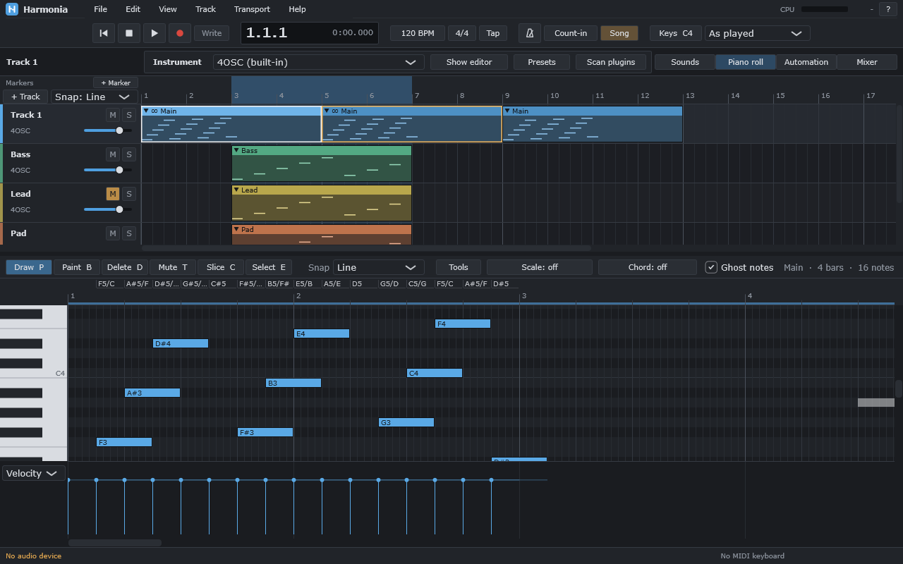
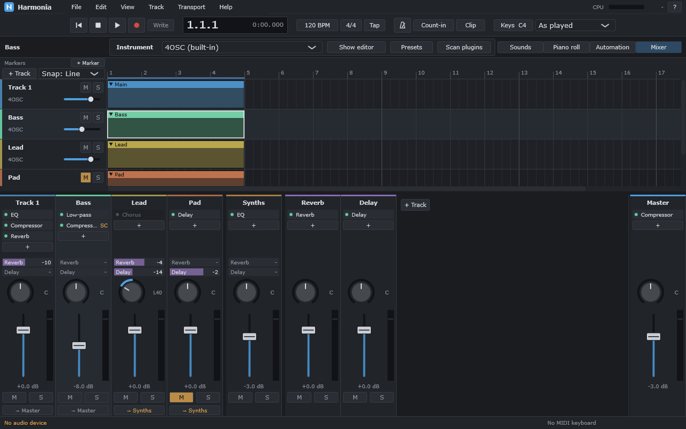
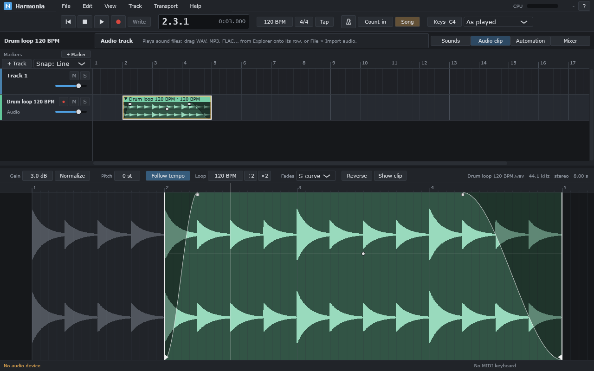
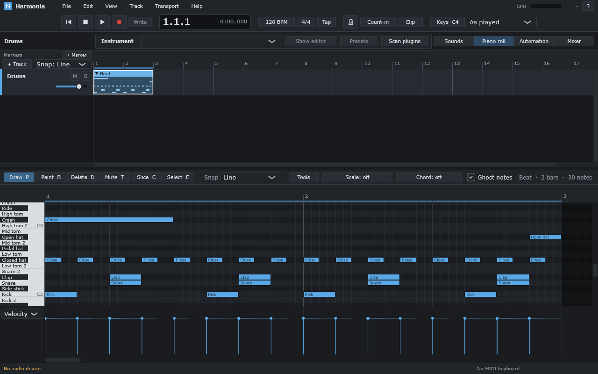

<div align="center">


# Harmonia

**English** | [Русский](README.ru.md)

**A free, open-source DAW with local AI tools**

A program for writing, recording and mixing music. It works offline and has no subscriptions.

[](https://github.com/Mapelisin/Harmonia/actions/workflows/ci.yml)


[**Download**](https://github.com/Mapelisin/Harmonia/releases/latest) · [Installation](docs/user/install.md) · [Cheat sheets](#cheat-sheets) · [Features](#what-it-can-do-already) · [Plans](#what-comes-next) · [Building](#building-from-source)



</div>

## About

Harmonia is a DAW (digital audio workstation): arrangement, piano roll, recording, mixer, effects,
automation, VST3 plugins, export. The main ideas:

- **The program itself comes first.** The DAW works fully without any AI models.
- **AI runs only on your computer.** Nothing goes to the cloud, and no internet is needed.
- **AI changes nothing on its own.** Every helper first shows and explains what it is going to do. The change
  happens when you press a button, you can hear it before you accept it, and one Ctrl+Z undoes it.
- **As few actions as possible.** A common musical task should not take extra steps.
- **A piano roll as comfortable as the one in FL Studio**, with a look of its own.

The project is under active development: the program already works, but these are early versions (0.x), so
expect bugs.

## What it can do already

<table>
<tr>
<td width="50%"><br><sub>Mixer: effects, sends, groups, sidechain</sub></td>
<td width="50%"><br><sub>Audio clip editor: fades, gain, stretching to the tempo</sub></td>
</tr>
</table>

**Piano roll**
- The Draw, Paint, Delete, Mute, Slice and Select tools; snapping to the grid; ghost notes of other tracks.
- Velocity, pan, fine pitch and other properties of every note; pitch bend, mod wheel, sustain pedal.
- A song scale with highlighting and snapping, a chord stamp, the name of the chord in the selected notes,
  key detection.
- Note commands: legato, chop, glue, Strum, Arpeggiate, Humanize, all with live preview.
- Recording from a MIDI keyboard and from the computer keyboard; shortcuts also work in the Russian keyboard
  layout.

**Arrangement**
- Clips on tracks, linked copies (edit one and all of them change), looping clips, markers, colours.
- Tempo changes along the song; inserting and deleting bars on all tracks at once.
- Editing by time, as in Ableton: drag across the rows to select a piece of time, whatever the clips'
  borders, then delete, cut, copy, paste, repeat or drag it.
- Track folders: neighbouring tracks collapse into one row with mute and solo for all of them.
- Freezing: a track with heavy plugins plays as audio, its plugins off, and unfreezes back.
- MIDI file import and export; a sound browser with preview.

**Audio**
- Audio tracks: drag in WAV, MP3, FLAC, AIFF or OGG files; record from a sound card input, with a count-in
  and loop recording of takes.
- Audio clip editor: fades, gain, reverse, normalize, stretching to the tempo and changing the pitch.
- Follow tempo puts any sample on the grid with one click: its tempo (72.3 BPM too) and first beat are
  measured from the sound itself.
- Overlapping audio clips crossfade by themselves; an audio clip can loop when made longer.

**Mixer and effects**
- Built-in effects: EQ, Compressor, Reverb, Delay, Chorus, Phaser, Filter, Pump, a limiter.
- Sends and return tracks, groups, sidechain; drag effects with the mouse, save effect chains to files.
- Automation of any knob; MIDI Learn and recording of knob movements.
- Presets for instruments and effects.

**Plugins**
- VST3 instruments and effects. Every plugin runs in a process of its own: if it crashes or hangs, the song
  keeps playing and the plugin can be restarted.
- A built-in synth and a built-in drum machine: any drum can play a sample of yours (drag a sound onto it).
- A step sequencer for drums: the clip as a grid of drums and steps.
- A sampler: any sound becomes an instrument that the keys play higher and lower.
- A plugin chooser: type two letters and press Enter; favourites and the ones used lately on top.

**Helpers** (they work by the rules of music theory and by exact measurements, without neural networks)
- Generators: chord progressions, drum grooves, a bass line and a melody for the chords, a song from a loop.
- Mix Doctor: a report on the mix and a fix for the levels; loudness for streaming (LUFS) with one button.

**Files and reliability**
- Export to WAV, FLAC and MP3; stems per track.
- Autosave and recovery after a crash; undo and redo (Ctrl+Z / Ctrl+Y).
- Earlier versions of a song kept at every save; all of a song's sounds collected into its folder, to move it
  to another computer; missing files found again.
- An installer for Windows.

<div align="center">
<br>
<sub>Drums in the piano roll: every row shows the name of its sound</sub>
</div>

## What comes next

- Sounds whose tempo drifts (live playing) put on the grid beat by beat.
- Local AI models: stem separation, a mastering helper, finding sounds by description.
- macOS (Apple Silicon).

There are no neural-network features in the program yet; they are planned. The details are in the
[project document](docs/PROJECT.md) (in Russian): the decisions made, the stages done and the next step.

## Installation

You need 64-bit Windows 10 or 11. The installer, `Harmonia-Setup-<version>.exe`, is on the
[**Releases**](https://github.com/Mapelisin/Harmonia/releases/latest) page; a new release comes out after every
fifth development stage. How to install it and what to answer to the Windows warning:
[docs/user/install.md](docs/user/install.md).

## Cheat sheets

| Topic | File |
|---|---|
| Piano roll | [docs/user/piano-roll.md](docs/user/piano-roll.md) |
| Arrangement | [docs/user/arrangement.md](docs/user/arrangement.md) |
| Mixer and effects | [docs/user/mixer.md](docs/user/mixer.md) |
| Automation | [docs/user/automation.md](docs/user/automation.md) |
| Plugins | [docs/user/plugins.md](docs/user/plugins.md) |
| Sounds | [docs/user/sounds.md](docs/user/sounds.md) |

Every cheat sheet also has a Russian version (the link is at the top of each one). In the program itself, F1
opens the list of shortcuts.

## Building from source

You need Windows 10/11 and Visual Studio 2026 with the C++ tools (CMake and Ninja come with it).

```bat
git clone https://github.com/Mapelisin/Harmonia.git
cd Harmonia
git -c url."https://github.com/".insteadOf="git@github.com:" submodule update --init --recursive
tools\build.cmd windows-release
```

This one command configures, builds and runs the tests. The program will be at
`build\windows-release\src\app\Harmonia_artefacts\Release\Harmonia.exe`.

The installer (needs Inno Setup 6): `tools\make-installer.cmd` → `build\installer`.

## How the code is organised

| Folder | What is inside |
|---|---|
| `src/core` | The project model: tracks, clips, notes, undo. No user interface |
| `src/audio` | The audio engine, devices, effects, export |
| `src/ui` | The interface: piano roll, arrangement, mixer, settings |
| `src/sandbox` | Separate processes for plugins |
| `src/app` | The entry point, the main window |
| `tests` | Automated tests (more than 500), including tests of the interface without a window |
| `docs` | The project document, architecture, research, cheat sheets |

Harmonia is built on [JUCE](https://juce.com) and [Tracktion Engine](https://github.com/Tracktion/tracktion_engine).
An overview of the architecture (in Russian): [docs/architecture/overview.md](docs/architecture/overview.md).

## License

There is no license file yet. **AGPLv3** is planned (JUCE and Tracktion Engine require it); the decision will be
confirmed after the licenses are checked. Until then the code is open for reading, but no rights to use it are
granted.
