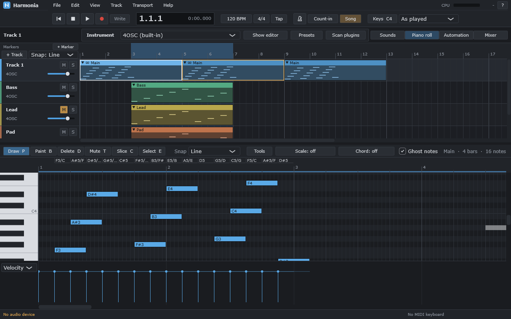
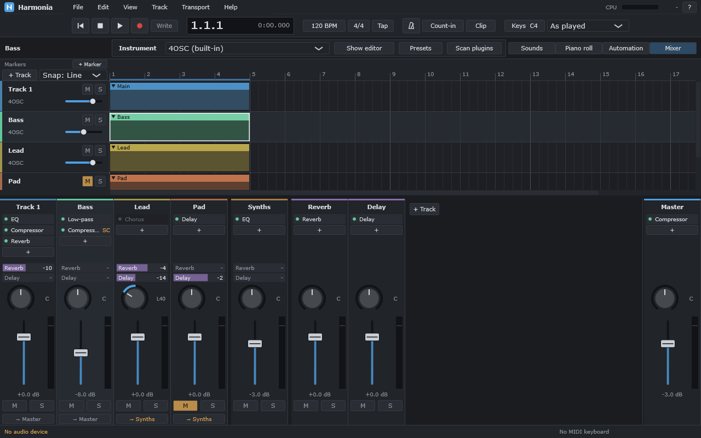
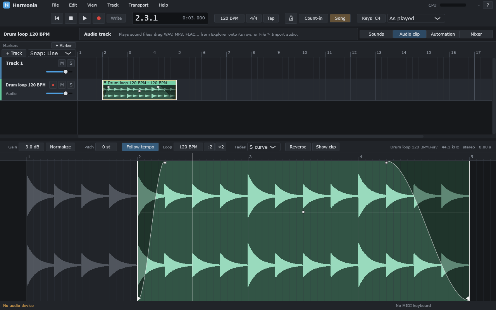
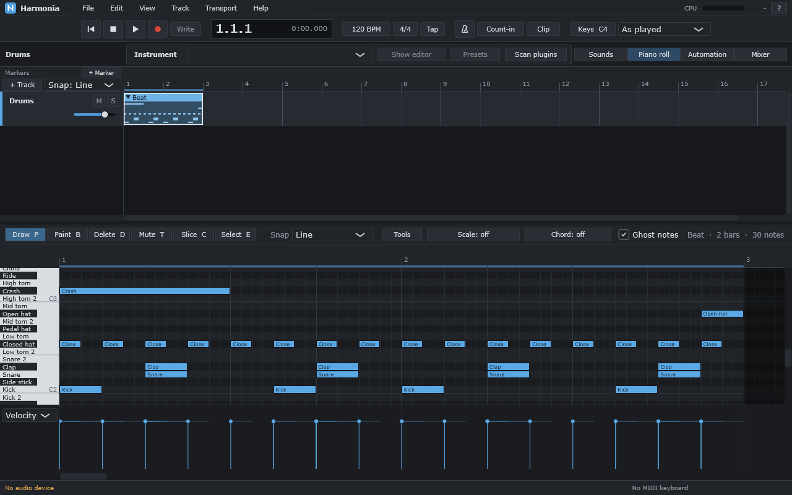

<div align="center">


# Harmonia

[English](README.md) | **Русский**

**Бесплатная DAW с открытым кодом и локальными ИИ-инструментами**

Программа для сочинения, записи и сведения музыки. Работает без интернета и без подписок.

[](https://github.com/Mapelisin/Harmonia/actions/workflows/ci.yml)


[**Скачать**](https://github.com/Mapelisin/Harmonia/releases/latest) · [Установка](docs/user/install.ru.md) · [Шпаргалки](#шпаргалки) · [Что умеет](#что-уже-умеет) · [Планы](#что-дальше) · [Сборка](#сборка-из-исходников)



</div>

## О проекте

Harmonia — это DAW (цифровая звуковая рабочая станция): аранжировка, piano roll, запись, микшер, эффекты,
автоматизация, плагины VST3, экспорт. Главные идеи:

- **Сначала сама программа.** Обычная DAW полностью работает без ИИ-моделей.
- **ИИ только локально.** Ничего не уходит в облако, интернет не нужен.
- **ИИ ничего не меняет сам.** Любой помощник сначала показывает и объясняет, что сделает; изменение — по кнопке,
  его слышно до принятия, отмена — одним Ctrl+Z.
- **Минимум действий.** Обычная музыкальная операция не должна требовать лишних шагов.
- **Piano roll уровня FL Studio** по удобству — с собственным оформлением.

Проект в активной разработке: программа уже рабочая, но это ранние версии (0.x) — возможны ошибки.

## Что уже умеет

<table>
<tr>
<td width="50%"><br><sub>Микшер: эффекты, посылы, группы, сайдчейн</sub></td>
<td width="50%"><br><sub>Редактор аудиоклипа: фейды, громкость, растяжение под темп</sub></td>
</tr>
</table>

**Piano roll**
- Инструменты Draw, Paint, Delete, Mute, Slice, Select; привязка к сетке, призрачные ноты других дорожек.
- Velocity, панорама, тонкая высота и другие свойства каждой ноты; pitch bend, колесо модуляции, педаль.
- Лад песни с подсветкой и привязкой, штамп аккордов, название аккорда выделенных нот, определение тональности.
- Команды нот: легато, нарезка, склейка, Strum, Arpeggiate, Humanize — с живым прослушиванием.
- Запись с MIDI-клавиатуры и с клавиатуры компьютера; горячие клавиши работают и в русской раскладке.

**Аранжировка**
- Клипы на дорожках, связанные копии (правка одной меняет все), повтор клипов, маркеры, цвета.
- Смена темпа по ходу песни, вставка и удаление тактов на всех дорожках.
- Папки дорожек: соседние дорожки сворачиваются в одну строку с общими mute и solo.
- Заморозка: дорожка с тяжёлыми плагинами играет как звук, плагины выключены; размораживается обратно.
- Импорт и экспорт MIDI-файлов, браузер звуков с прослушиванием.

**Звук**
- Аудиодорожки: файлы WAV, MP3, FLAC, AIFF, OGG перетаскиванием; запись с входа звуковой карты, предотсчёт,
  запись дублей по кругу.
- Редактор аудиоклипа: фейды, громкость, реверс, нормализация, растяжение под темп и смена высоты.
- Наложенные аудиоклипы сами плавно переходят один в другой; аудиоклип повторяется по кругу, если его растянуть.

**Микшер и эффекты**
- Встроенные эффекты: EQ, Compressor, Reverb, Delay, Chorus, Phaser, Filter, Pump, лимитер.
- Посылы и возвратные дорожки, группы, сайдчейн; эффекты переносятся мышью, цепочки сохраняются в файлы.
- Автоматизация любой ручки; MIDI Learn и запись движения ручек.
- Пресеты инструментов и эффектов.

**Плагины**
- VST3-инструменты и эффекты. Каждый плагин работает в отдельном процессе: если он упал или завис,
  песня играет дальше, а плагин можно перезапустить.
- Встроенные синтезатор и драм-машина: любой барабан может играть ваш сэмпл (перетащите звук на него).
- Пошаговый секвенсор для барабанов: клип как сетка «барабаны × шаги».

**Помощники** (работают по правилам теории музыки и точным измерениям, без нейросетей)
- Генераторы: последовательности аккордов, барабанный грув, бас и мелодия под аккорды, песня из лупа.
- Mix Doctor: отчёт по миксу и исправление уровней; громкость для стриминга (LUFS) одной кнопкой.

**Файлы и надёжность**
- Экспорт в WAV, FLAC и MP3, стемы по дорожкам.
- Автосохранение и восстановление после сбоя; отмена и повтор действий (Ctrl+Z / Ctrl+Y).
- Установщик для Windows.

<div align="center">
<br>
<sub>Барабаны в piano roll: у каждой строки — имя звука</sub>
</div>

## Что дальше

- Сэмплер (любой звук как инструмент), выбор плагина с поиском и избранным, резервные копии песни.
- Локальные ИИ-модели: разделение на стемы, помощник мастеринга, поиск звуков по описанию.
- macOS (Apple Silicon).

Нейросетевых функций в программе пока нет — они в планах. Подробно — в [проектном документе](docs/PROJECT.md):
принятые решения, сделанные этапы и следующий шаг.

## Установка

Нужна 64-битная Windows 10 или 11. Установщик `Harmonia-Setup-<версия>.exe` — на странице
[**Releases**](https://github.com/Mapelisin/Harmonia/releases/latest); новый выпуск выходит после каждого пятого
этапа разработки. Как поставить и что ответить на предупреждение Windows — [docs/user/install.ru.md](docs/user/install.ru.md).

## Шпаргалки

| Тема | Файл |
|---|---|
| Piano roll | [docs/user/piano-roll.ru.md](docs/user/piano-roll.ru.md) |
| Аранжировка | [docs/user/arrangement.ru.md](docs/user/arrangement.ru.md) |
| Микшер и эффекты | [docs/user/mixer.ru.md](docs/user/mixer.ru.md) |
| Автоматизация | [docs/user/automation.ru.md](docs/user/automation.ru.md) |
| Плагины | [docs/user/plugins.ru.md](docs/user/plugins.ru.md) |
| Звуки | [docs/user/sounds.ru.md](docs/user/sounds.ru.md) |

У каждой шпаргалки есть и английская версия (ссылка — вверху). В самой программе список горячих клавиш открывается по F1.

## Сборка из исходников

Нужны Windows 10/11 и Visual Studio 2026 с инструментами C++ (CMake и Ninja входят в её состав).

```bat
git clone https://github.com/Mapelisin/Harmonia.git
cd Harmonia
git -c url."https://github.com/".insteadOf="git@github.com:" submodule update --init --recursive
tools\build.cmd windows-release
```

Одна команда настраивает, собирает и запускает тесты. Программа появится в
`build\windows-release\src\app\Harmonia_artefacts\Release\Harmonia.exe`.

Установщик (нужен Inno Setup 6): `tools\make-installer.cmd` → `build\installer`.

## Как устроен код

| Папка | Что внутри |
|---|---|
| `src/core` | Модель проекта: дорожки, клипы, ноты, отмена. Без интерфейса |
| `src/audio` | Звуковой движок, устройства, эффекты, экспорт |
| `src/ui` | Интерфейс: piano roll, аранжировка, микшер, настройки |
| `src/sandbox` | Отдельные процессы для плагинов |
| `src/app` | Точка входа, главное окно |
| `tests` | Автотесты (больше 500), в том числе интерфейса без окна |
| `docs` | Проектный документ, архитектура, исследования, шпаргалки |

Основа — [JUCE](https://juce.com) и [Tracktion Engine](https://github.com/Tracktion/tracktion_engine).
Обзор архитектуры — [docs/architecture/overview.md](docs/architecture/overview.md).

## Лицензия

Файла лицензии пока нет. Планируется **AGPLv3** (её требуют JUCE и Tracktion Engine); решение будет подтверждено
после проверки лицензий. До этого код открыт для чтения, но права на его использование не переданы.
